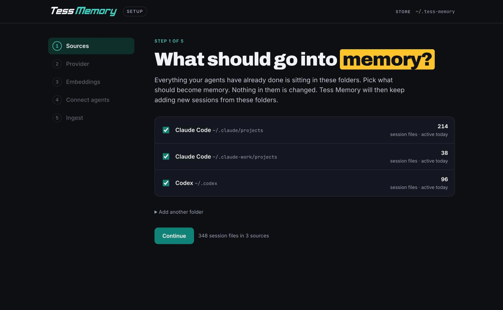

# Setup

`tess-memory setup` is the quickest way to a working memory. It opens a page on your own
machine and takes you from a fresh clone to a store that keeps itself current, without
writing a settings file.

```sh
uv run tess-memory setup
```



It serves the page on `127.0.0.1` and opens it in your browser. The page needs the one-time
link printed in your terminal, so nothing else on the machine or the network can drive it.

## The five steps

### 1. Sources

Setup finds the Claude Code, Codex and Antigravity folders on your disk and shows how many
session files each holds. Tick the ones that should become memory. Their files are only read, never
changed. You can add any other folder by hand: a Tess Core agent's sessions, or a folder
of plain transcripts.

### 2. Provider

Tess Memory uses a model to distil sessions into memories and to search them. Connect one
of:

- **A ChatGPT account.** Sign in and use your ChatGPT plan. There is no key to manage.
- **An API key.** Anthropic, OpenAI or Google Gemini, billed to your API account.
- **Your own endpoint.** Any OpenAI-compatible service, including a model on your own
  hardware.

Setup then lists the models that account offers. Pick one for distilling and one for
searching. Each is tested with a real request before you continue.

### 3. Embeddings

An embedding model lets search match on meaning, not just words. Choose one of:

- **On this machine.** A small model, downloaded once, then fully offline.
- **Google.** Gemini embeddings, with your own API key.
- **Your own endpoint.** Any OpenAI-compatible embeddings service.

You can change this later. See [changing the embedding model](#changing-the-embedding-model).

### 4. Connect agents

Every Claude Code, Codex and Antigravity home on the machine is listed, whether or not you
chose it as a source. Which sessions are ingested and which agents can use the memory are separate
choices.

Connecting an agent does two things:

- registers the memory server with it, through the agent's own command;
- adds a "Memory and planning" section to its instruction file (`CLAUDE.md` for Claude
  Code, `AGENTS.md` for Codex, `GEMINI.md` for Antigravity), so the agent uses its memory
  without being asked.

A file that already has that section is left exactly as it is, and a file that is changed
is first copied beside itself. For any other MCP client, the page shows the configuration
and the instructions to paste.

### 5. Ingest

Setup ingests a first batch of up to 25 sessions while you watch. With **Keep ingesting in
the background** ticked, which it is by default, it also installs the
[scheduler](scheduler.md) as a login service at that moment. The scheduler ingests the rest
of your history and every new session from then on.

You can close the page as soon as ingestion has started. Both the first batch and the
background service carry on without it.

A long history takes hours and uses your model plan. That cost is paid once: a session is
distilled once, and only what is added to it later is distilled again.

## Where things go

Setup writes ordinary files into the store's folder, `~/.tess-memory` unless you pass
`--home`:

| File | What it is |
|---|---|
| `settings.toml` | The [settings file](configuration.md) every command reads |
| `providers.yaml` | The provider profiles. It holds no key |
| `scheduler.toml` | The background service's configuration |
| `setup.json` | Setup's own notes: your choices so far. No key or token |
| `setup-ingest.log` | The log of the batch setup started |

**Keys** go to your system keychain: the macOS Keychain, or the Secret Service on Linux.
The provider file holds only a reference to each one. On a machine with no keychain, start
setup with `--no-keychain` and keys are kept in a file only your user can read. A ChatGPT
sign-in needs the keychain.

You can edit any of these files by hand afterwards. Setup is not needed again.

## Running it again

Run `tess-memory setup` again to change anything. It remembers your choices and opens
where you left off.

- A settings file it replaces is kept beside the new one as a dated copy.
- A store you configured by hand can be run through setup too. Setup starts from the
  sources your settings file lists, with their names, and offers the other agents on the
  machine unticked. When it saves, it decides the sources, the model, the search model and
  the embedding model. Everything else in your file is carried into the new one: each
  kept source's own options (`project`, `exclude`, `skip_copies_of`, `user`, `team`), the
  keys of `[ingest]` and `[storage]`, the tuning in `[llm]` and `[search]`, and every
  section setup has no page for. Keys that name the earlier provider, such as a fallback
  profile, are not carried, and neither are comments; the dated copy has both.
- A new settings file is checked before it replaces the old one. If Tess Memory would
  refuse it, the old file stays in place.
- Nothing already ingested is done again. Changing the provider, the models or any other
  setting never re-distils a session. See
  [what never redoes your memory](ingestion.md#what-never-redoes-your-memory).
- The plan board is never touched.

### Changing the embedding model

A store's vectors all come from one embedding model, so choosing another on a store that
already holds memory means embedding those memories again. Setup notices, says how many
memories are involved, and re-embeds from the page with a progress bar.

- Nothing is distilled again, and the plan is not touched.
- Search and ingestion keep working with the current model until every memory is done.
  The store and its settings then switch together.
- Stopping is safe. Nothing switches until it is finished, and it continues from where it
  stopped.
- Anything else you changed in the same pass takes effect straight away.

The same thing from the command line is [`tess-memory reembed`](models.md#embeddings).

## Options

```sh
tess-memory setup --home ~/work-memory   # another store folder
tess-memory setup --no-browser           # print the link, do not open it
tess-memory setup --no-keychain          # keep keys in a private file
tess-memory setup --port 4600
```

`--no-browser` is for a machine you reach over SSH: forward the port, then open the link
on your own computer.

## If something goes wrong

- **A model test fails.** The page shows the provider's answer. Check the key, and that
  the account may call that model.
- **The first batch stops.** Its last lines are shown on the page, and the whole log is in
  `setup-ingest.log` in the store's folder.
- **Nothing new is being ingested later.** Ask the scheduler what it last did:

  ```sh
  tess-memory scheduler --config ~/.tess-memory/scheduler.toml status
  ```

  A session is only ingested once it has been unchanged for 15 minutes, so a conversation
  you just finished is picked up a little later.
- **You would rather not use the page.** Everything setup does can be done by hand:
  see [Getting started](getting-started.md) and [Configuration](configuration.md).
